<p align="center">
  <picture>
    <source media="(prefers-color-scheme: dark)" srcset="assets/brand/gentra-island-wordmark-white.svg">
    
  </picture>
</p>

<h1 align="center">A free Dynamic Island for Mac, Windows, and Linux</h1>

<p align="center">
  Turn your MacBook's notch into something useful. Gentra Island tells you when Claude Code needs you, reminds you to drink some water, shows what's playing, and remembers what you copy. Then it slips back into the notch.
</p>

<p align="center">
  <a href="https://github.com/Adamfatur/gentra-island/releases/latest"></a>
  <a href="https://github.com/Adamfatur/gentra-island/releases"></a>
  
  <a href="LICENSE"></a>
  <a href="https://github.com/Adamfatur/gentra-island/actions/workflows/ci.yml"></a>
</p>

<p align="center">
  <a href="https://github.com/Adamfatur/gentra-island/releases/latest"><b>Download</b></a> |
  <a href="INSTALL.md">Install guide</a> |
  <a href="#how-to-use">How to use</a> |
  <a href="PRIVACY.md">Privacy</a> |
  <a href="TERMS.md">Terms</a>
</p>

<p align="center">
  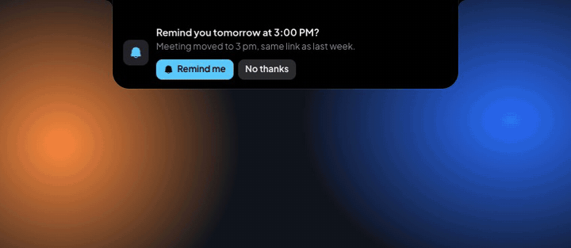
</p>

---

**Free and open source. No account, no tracking, about 1% CPU.**

Gentra Island sits at the top of your screen. On a Mac with a notch it hides inside the camera housing until something is happening, so your menus stay visible; elsewhere it floats as a small pill. Hover, click, or press **⌥⌘G** (**Ctrl+Alt+G** on Windows and Linux) to open it. It speaks up by itself only when something is worth seeing: Claude Code waiting for your answer, a long build that finished, a call that started, or an hour without a break.

**New in 1.0: Droplets.** The island has a new look. A black core grows out of the notch and says the one thing that matters right now, and droplets hang under it, one per feature. Tap one and it grows into a full view. On macOS 26 the droplets are real Liquid Glass; older Macs get frosted ones, Windows and Linux solid ones.

- **AI agents:** see when Claude Code or Codex is working, needs you, or is done, **allow or deny Claude Code's permission requests from the notch**, and see how many tokens you've used today and this week
- **Smart screenshots:** copy the text out of any screenshot with one click, saved or copied with ⌃⇧⌘4, read on your computer
- **Eyes in the notch:** two glowing pixel eyes sit either side of the camera, follow your pointer, and smile when a task is done
- **Download progress** in the notch, with Open when it's done
- **Gentle care:** a warm nudge to take a break, drink water, eat, and stop when it gets late, never more than 8 a day
- **Now playing** for Spotify, Apple Music, YouTube, and more, with artwork and controls
- **Clipboard history** that understands what you copied, keeps secrets out of it, and cleans up after itself
- **Reminders** from what you copy: copy "meeting Friday at 2 pm" and it offers to remind you
- **Shelf** for files, **focus timer**, **system monitor**, and a **safe cleaner**
- **For developers:** see and stop local servers, get told when long commands finish
- **For calls:** which app has your mic, call time, mute, and a camera mirror
- **Steps aside** over full-screen videos and apps on a Mac, as a thin line

## Screenshots

| | |
|---|---|
| 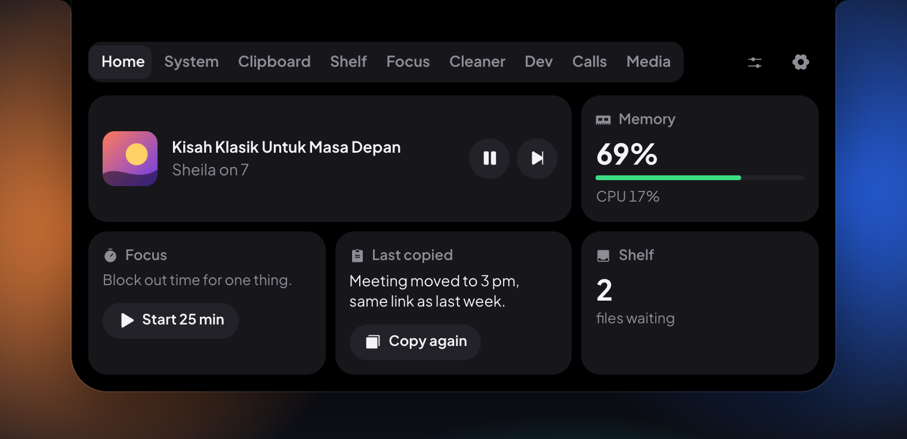 | 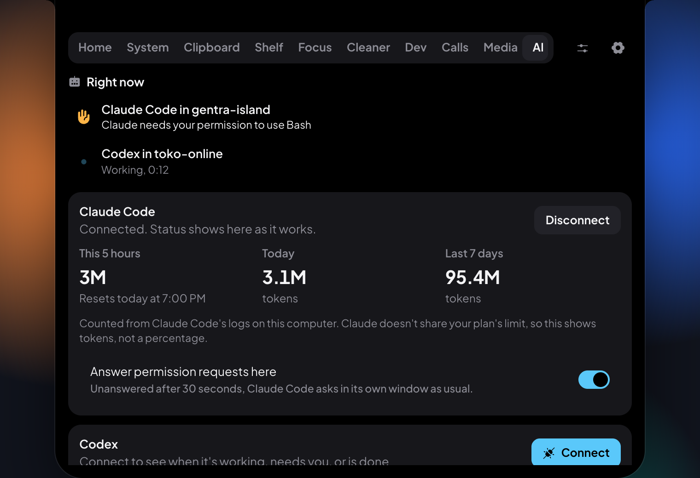 |
| **Home**: the core says what matters, droplets for the rest | **AI agents** shows your agents and how much you've used |
| 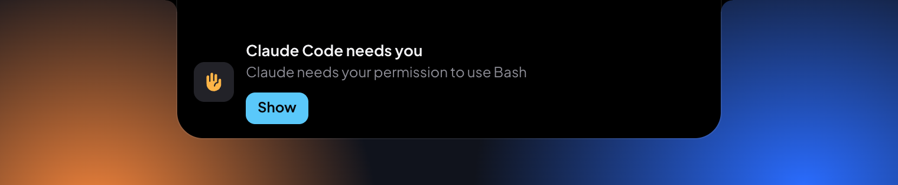 | 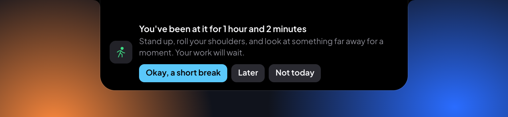 |
| A peek when Claude Code needs your answer | **Gentle care** reminds you to stand up |
| 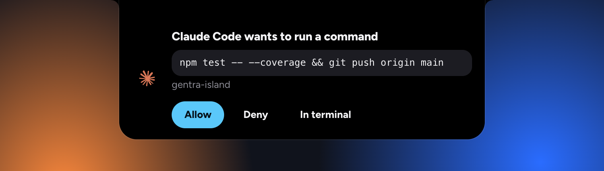 | 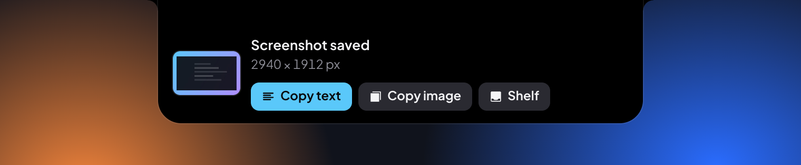 |
| **Approve** Claude Code's requests from the notch | **Copy the text** out of a screenshot |
| 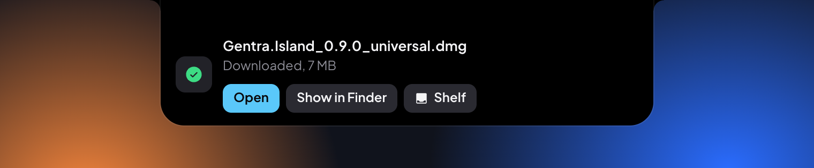 | 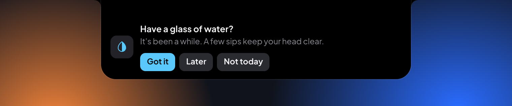 |
| **Downloads** in the notch | And to drink some water |
| 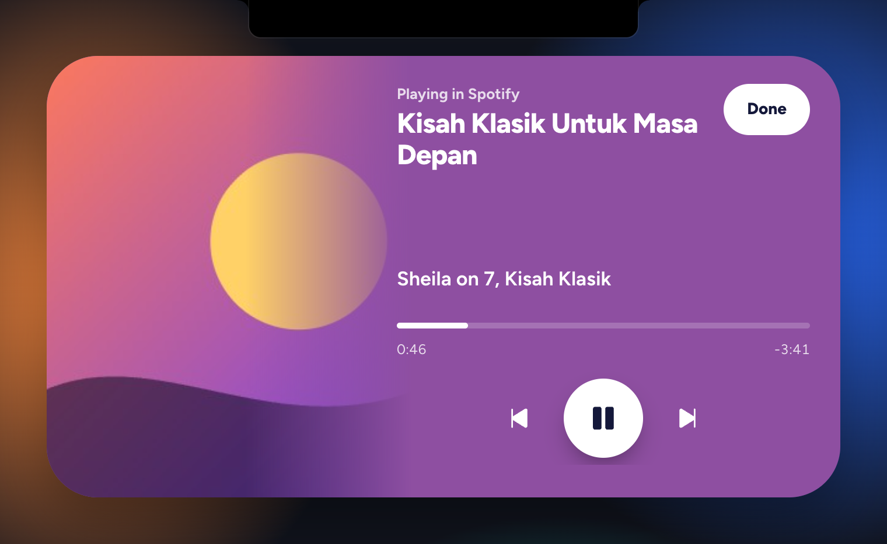 |  |
| **Media** controls whatever is playing | **Eyes** beside the camera follow your pointer |
| 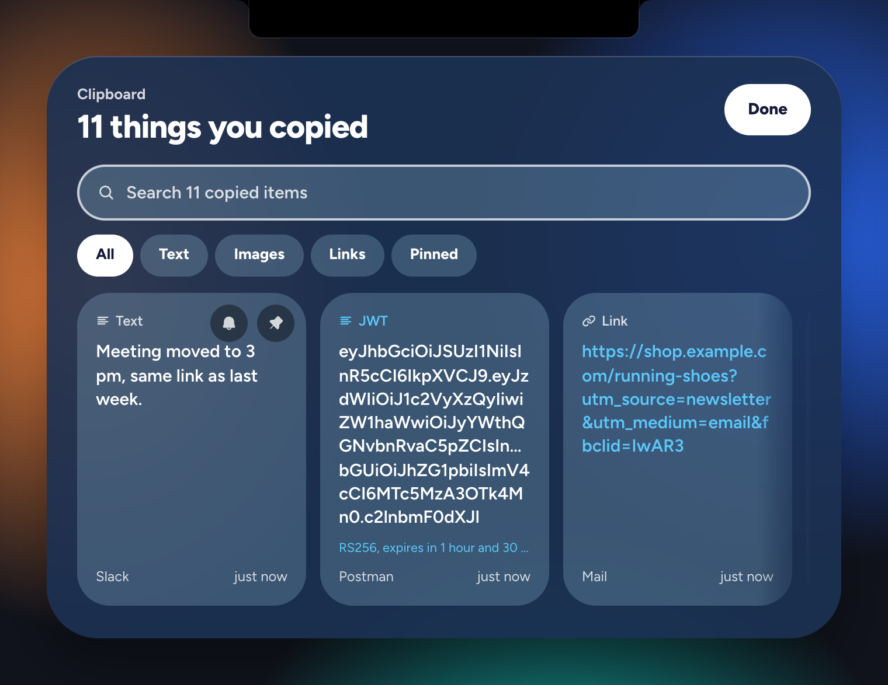 | 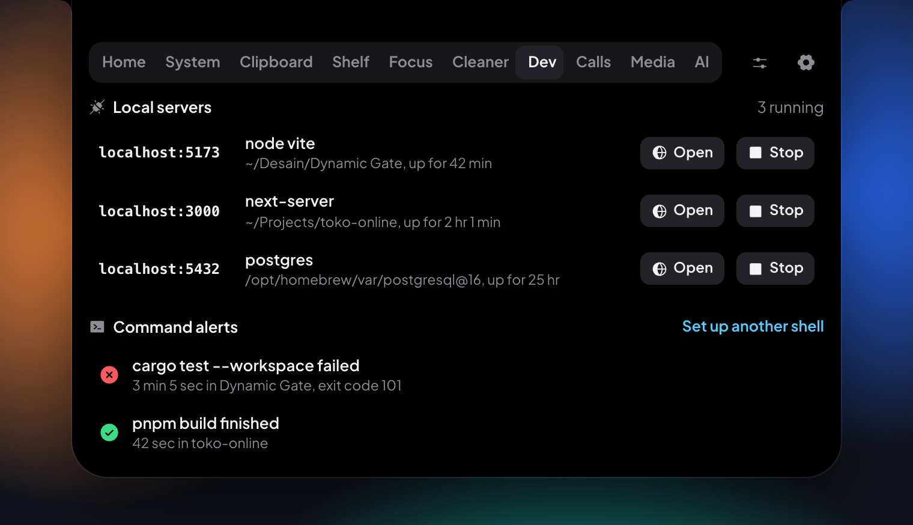 |
| **Clipboard** remembers and understands what you copy | **Dev** watches your local servers and long commands |
| 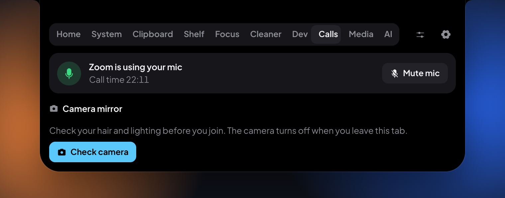 | 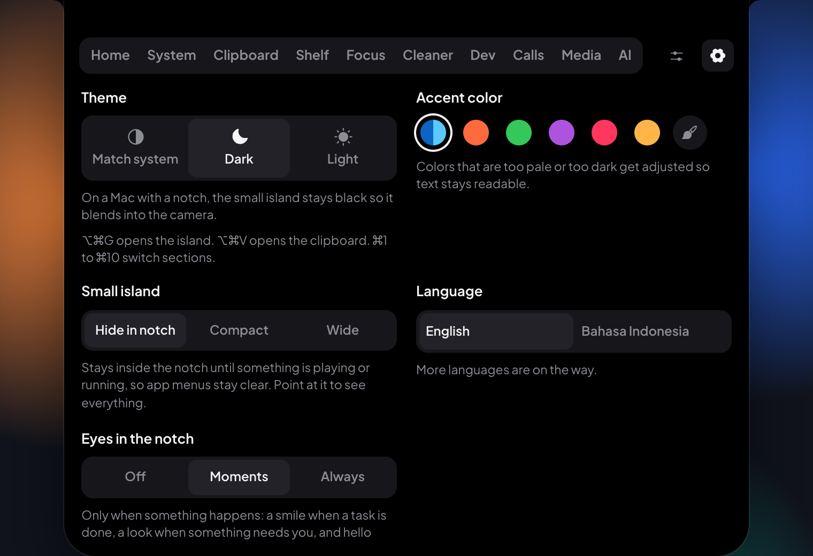 |
| **Calls** shows who has your mic | **Settings**: theme, accent, and how long the clipboard keeps things |
| 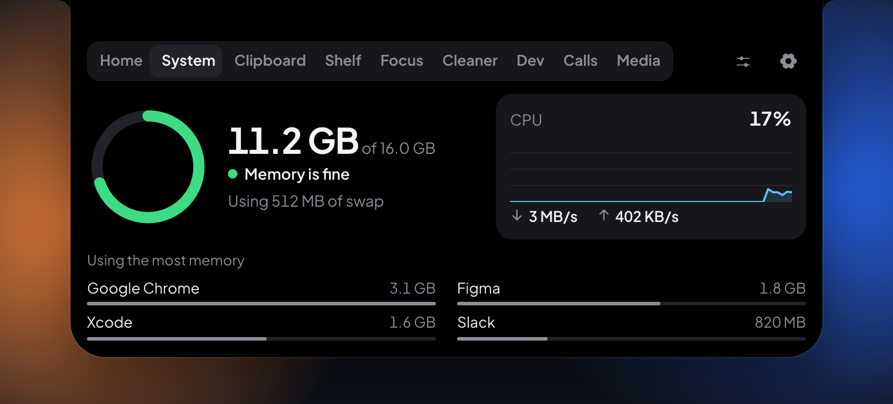 | 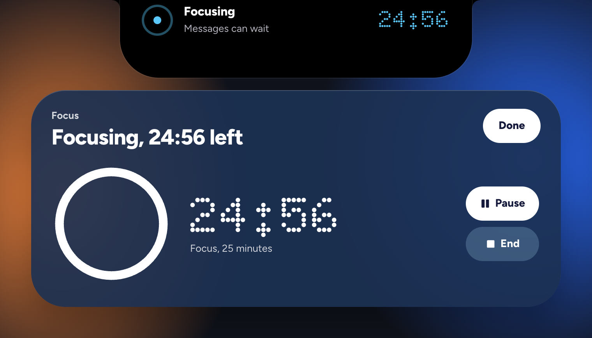 |
| **System** shows memory, CPU, and network | **Focus** counts down in the core |
| 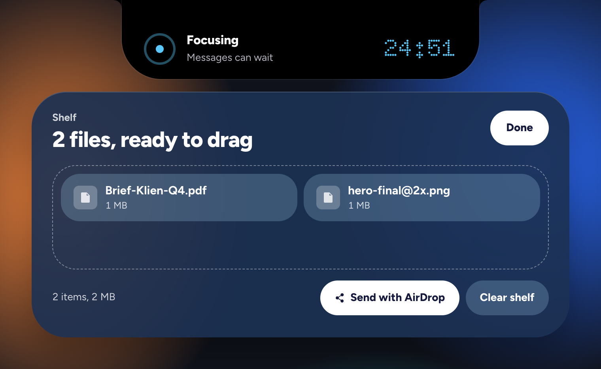 | 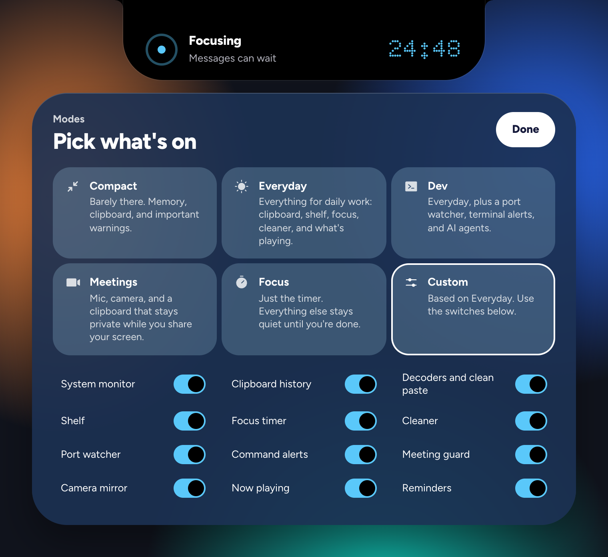 |
| **Shelf** holds files until you drag them out | **Modes** pick what's on |
| 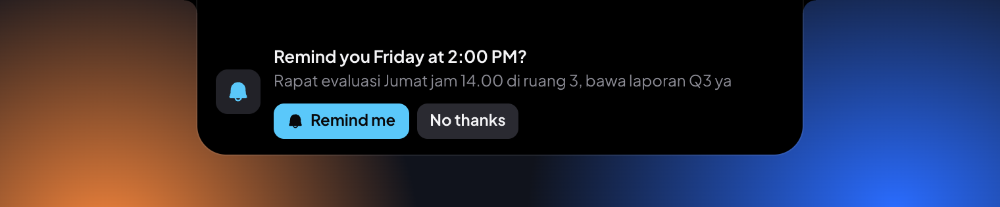 | 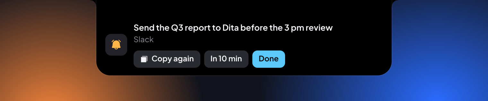 |
| **Reminders** offered when what you copy has a time in it | A reminder when it's due |
| 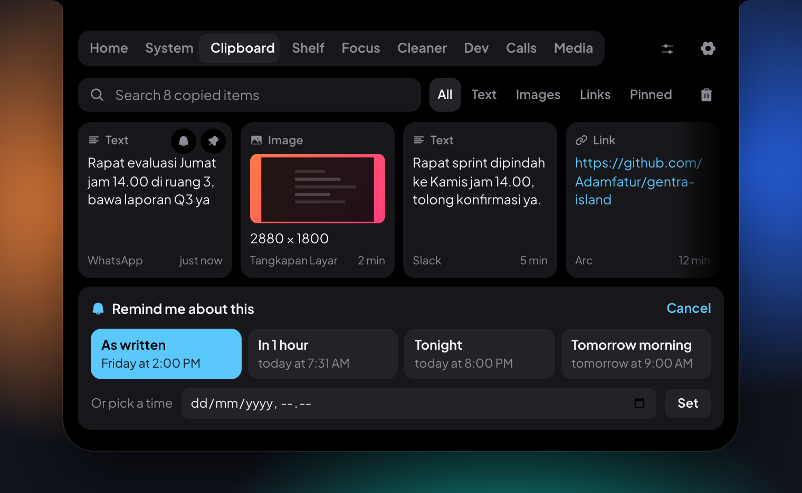 |  |
| Remind yourself about anything you copied | Two droplets beside the notch while music plays |
| 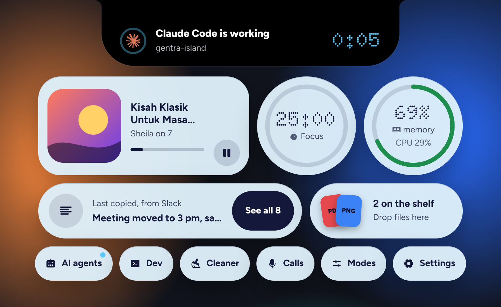 | |
| Light theme | |

A higher-quality version of the video is in [docs/screenshots/demo.mp4](docs/screenshots/demo.mp4). For a 50-second tour of every feature, with music, watch [docs/screenshots/tour.mp4](docs/screenshots/tour.mp4).

## What it does

| | |
|---|---|
| **Droplets** | The look since 1.0. A black core grows from the notch and shows the one thing that matters now: an agent that needs you, a call, an agent at work, a focus session, or a download. Droplets hang under it, one per feature; tap one and it grows into a full view, tap **Done** or press **Esc** and it goes back. Liquid Glass on macOS 26 and newer. Set `GENTRA_CLASSIC=1` to start the old island instead. |
| **Home** | One glance: what's playing, memory, a focus timer, what you copied last, files on your shelf, and a call if one is live. |
| **Now playing** | Music or video from Spotify, Apple Music, YouTube, and other players. Play, pause, skip, and drag to seek. Artwork and a level meter in two droplets beside the notch. |
| **Clipboard** | History of text, links, code, colors, and screenshots. Search, pin, filter. Press **⌥⌘V** (**Ctrl+Alt+V**). Every image has **Copy text**, old ones too. It cleans up after itself: keep things 1, 7, or 30 days, or until it's full, with at most 60 images; pinned items always stay. Settings shows how much space it takes. |
| **Reminders** | Copy "rapat Jumat jam 14.00" or "meeting moved to 3 pm" and the island offers to remind you, in one click. Any clipboard item can get a reminder: in an hour, tonight, tomorrow morning, or any time. Times are understood in English and Indonesian, on your computer. |
| **Smart paste** | Decodes JWTs, timestamps, base64, JSON, URL encoding, and cron. Strips link trackers. Masks ID and card numbers on request. |
| **Secret guard** | API keys and private keys are never written to disk, shown only masked, and leave history and the clipboard after 60 seconds. |
| **Shelf** | Drop files on the island to hold them, drag them out to any app, or send them with AirDrop on macOS. |
| **Focus** | 5, 15, 25, or 50 minute sessions with the countdown on the small island. |
| **System** | Memory (with real memory pressure on macOS), CPU, network, swap, and the apps using the most memory. |
| **Cleaner** | Moves safe-to-delete caches, old logs, and old installers to the Trash or Recycle Bin. Never touches documents, photos, or settings. |
| **Dev** | Local servers by port, with their folder: open or stop them. Alerts when a terminal command of 10 seconds or more finishes. |
| **Approve from the notch** | When Claude Code asks for permission, the notch shows the command in full with **Allow**, **Deny**, and **In terminal**. Reads that arrive together get one **Allow all**; commands and edits are always answered one by one. Turn off **Show requests to read files** and the notch only interrupts you for commands and edits. Unanswered after 30 seconds, Claude Code asks in its own window as usual. |
| **Smart screenshots** | A new screenshot shows on the island: **Copy text** reads the text in it on your computer (Vision on macOS, the built-in OCR on Windows, tesseract on Linux), or copy the image, or put it on the shelf. |
| **Downloads** | Files your browser is downloading show in the notch, then **Open**, **Show in Finder**, or **Shelf** when they're done. |
| **Gentle care** | Warm reminders for the small things that matter: a break after about 50 minutes of real activity, water every hour and a half, lunch and dinner, and a word when it's past eleven. Five minutes away from the keyboard counts as a break. Never during a call, a focus session, or Focus mode, at least 20 minutes apart, and no more than 8 a day. Every reminder has **Later** and **Not today**. |
| **AI agents** | Claude Code and Codex on the island: a clock while they work, a nudge when they need you, and a note when a long task is done. Usage from their local logs: tokens in the latest session, today, and the last 7 days, plus Codex's own 5-hour and weekly limits when it reports them. Claude doesn't share its plan limit or reset time, so the island doesn't guess them. |
| **Calls** | Which app is using your mic, the call time on the small island, a system mute button on macOS, and a camera mirror. |
| **Full screen** | On a Mac, over a full-screen video or app, the island shrinks to a thin line, and comes back when you leave. |

**Modes** keep it as small as you want. Compact, Everyday, Dev, Meetings, and Focus are presets; switch any feature on or off. A switched-off feature stops its background work, not just its tab.

The interface speaks eleven languages: English, Bahasa Indonesia, Español, Português, Français, Deutsch, 日本語, 한국어, 简体中文, हिन्दी, and العربية, right to left included. The nine newest were drafted with AI help and still want a native speaker's read; see [docs/TRANSLATING.md](docs/TRANSLATING.md) to help.

## System requirements

| | Minimum | Recommended |
|---|---|---|
| **macOS** | macOS 11 Big Sur, Intel or Apple silicon | macOS 15 Sequoia or newer |
| **Windows** | Windows 10 version 1809, 64-bit (x64) | Windows 11 |
| **Linux** | 64-bit (x86_64) with WebKitGTK 4.1: Ubuntu 22.04, Debian 12, Fedora 37, Linux Mint 21, or newer | An X11 session |
| **Memory** | 4 GB RAM | 8 GB RAM |
| **Disk** | 30 MB free | |

### Tested so far

Being clear about what has and hasn't been tried on real machines:

| System | Status |
|---|---|
| macOS 27 on Apple silicon | Used daily during development |
| macOS 11 to 26, Intel Macs | Builds for them; not yet run on them |
| Windows 10 and 11 | Builds in CI; not yet run on a real machine |
| Linux | Builds in CI; not yet run on a real machine |

If you run it on something not marked as tested, an issue saying how it went helps a lot.

## Install

Get the file for your system from the [latest release](../../releases/latest). No terminal needed.

### macOS

1. Download the file ending in `.dmg`. It runs on Intel and Apple silicon Macs.
2. Open it and drag **Gentra Island** into **Applications**.
3. Open Gentra Island from Applications.
4. If the Mac says it can't check the app for malware: open **System Settings**, go to **Privacy & Security**, scroll down, and click **Open Anyway**. This happens once, because the app isn't notarized by Apple yet.
5. The first open can take a few minutes on some Macs while macOS checks the app, with nothing on screen yet. Wait a moment: the island then appears at the top of the screen with a short guide. There's no Dock icon; to find it again, click the **G** in the menu bar.

### Windows

1. Download the file ending in `-setup.exe`.
2. Double-click it and click **Install**. No admin password needed.
3. If Windows shows "Windows protected your PC", click **More info**, then **Run anyway**. This happens once, because the app isn't code-signed yet.

### Linux

- **Any distro**: download the `.AppImage`, right-click it, open **Properties**, switch on **Allow executing as program**, then double-click it.
- **Ubuntu, Debian, Mint**: download the `.deb` and double-click it to open it in your software center.
- **Fedora, openSUSE**: download the `.rpm` and double-click it.

To check your download, compare it with `SHA256SUMS.txt` on the release page. More detail, including uninstalling, is in [INSTALL.md](INSTALL.md).

## How to use

**The basics**

1. After you open it, the island sits at the top center of your screen, small. A short guide shows up the first time.
2. **Hover** over it, **click** it, or press **⌥⌘G** (**Ctrl+Alt+G**) to open it. Move away, press **Esc**, or press the shortcut again to close it.
3. Tap a droplet to open its view, and **Done** or **Esc** to go back. **⌘1** to **⌘9** (**Ctrl+1** to **Ctrl+9**) jump straight to one.
4. The **Modes** droplet picks which features are on. Choose **Compact** if you only want memory and the clipboard, or switch features one by one.
5. The **Settings** droplet has the theme, accent color, how long the clipboard keeps things, language, open at login, one-click updates, and About.

**Everyday things**

- **Paste something you copied earlier**: press **⌥⌘V** (**Ctrl+Alt+V**), type to search, use the arrow keys, and press **Enter** to copy it back. **P** pins an item so it stays.
- **Understand what you copied**: hover a clipboard card. A JWT shows who it's for and when it expires, a timestamp shows the date, a tracking link offers a clean copy.
- **Control music or a video**: open **Media**, or use the buttons on **Home**. Drag the bar to jump; **Space** plays and pauses.
- **Hold files for later**: drag files onto the island. They wait on the **Shelf** until you drag them out to another app, or send them with **AirDrop** on a Mac.
- **Focus for a while**: on **Home**, click **Start 25 min**, or pick a length in **Focus**. The countdown stays on the small island.
- **Free up space**: open **Cleaner**, review what it found, and click the button to move it to the Trash. Nothing outside the safe list is touched.

**Reminders**

- **When you copy something with a time in it**, like "rapat Jumat jam 14.00" or "call at 3 pm", the island asks "Remind you Friday at 2:00 PM?". Click **Remind me**, or ignore it.
- **For anything else you copied**, hover its card in **Clipboard** and click the bell (or press **R**). Pick **As written** (when the text has a time), **In 1 hour**, **Tonight**, **Tomorrow morning**, or any date and time.
- **When it's due**, the island opens a little with the text: **Copy again**, **In 10 min**, or **Done**. Upcoming reminders are listed on **Home**, where you can cancel them.
- A reminder that came due while Gentra Island was closed shows as soon as it starts again.

**For developers**

- **See and stop local servers**: open **Dev**. Each server shows its port, folder, and how long it has run; **Open** opens it in your browser, **Stop** asks once more, then stops it.
- **Get told when a long command finishes**: in **Dev**, pick your shell, click **Copy line**, paste it at the end of your shell config, and open a new terminal. Commands of 10 seconds or more show up on the island when they finish.
- **Watch Claude Code or Codex**: open **AI** and click **Connect** next to the agent. The island explains what it will change before it does it: one small script is added to the agent's hook settings (`~/.claude/settings.json` or `~/.codex/hooks.json`), with a backup of the file kept next to it. New sessions then report when they start working, when they need you, and when they finish. **Disconnect** takes the script out again.

**In calls**

- When an app starts using your mic, the small island shows the call time. Open **Calls** to see which app it is, and on a Mac, mute the mic for every app at once.
- **Check camera** in **Calls** shows a mirror before you join. If the camera is blocked, the island walks you through allowing it.

## Permissions

Gentra Island asks for as little as possible. When something needs your OK, the island shows numbered steps for your system and a button that opens the right settings page.

| Permission | Used for | When it's asked |
|---|---|---|
| Camera | The camera mirror in the Calls tab | Only when you click **Check camera** |
| Automation (macOS) | Asking your browser which tab is playing, to show a YouTube thumbnail | Only if you switch on **Show thumbnails** in the Media tab |

Nothing else needs a permission prompt. Seeing which app uses the mic doesn't record audio, and the clipboard, shelf, and system monitor use access every app already has.

## Privacy

The full [Privacy Policy](PRIVACY.md) explains what is stored where and how to delete it. In short:

- **Everything stays on your computer.** No accounts, no analytics, no telemetry.
- **Few network calls, each one you can turn off.** Once a day it downloads `latest.json` from this repo's releases to see if there's a new version (turn it off in Settings, Updates); nothing about you is sent. It also reaches the network when you click a link it shows, such as opening a local server in your browser, and, only if you switch on **Show thumbnails** in the Media tab, to load a YouTube video's thumbnail from `i.ytimg.com`.
- **Reminders** and **clipboard history** are stored in your user's app data folder. Secrets are never written there. History older than you chose (30 days by default) is removed by itself, and **Clear history** in Settings removes it all.
- **Gentle care** asks the system how long since you last touched the keyboard or mouse, a single number. It never sees what you type.
- **AI agents.** Usage is read from the agents' own logs on your computer, and only the token counts are kept. Connecting adds a hook that tells the island the project folder name and, when an agent asks you something, its question. Your prompts, code, and logins are never read or sent.
- **The mic is never opened.** The meeting guard only asks the system whether an app is using it.
- **The camera** is on only while the mirror is visible, and nothing is recorded.
- **Full-screen check (macOS).** To step aside, the island asks the system where other apps' windows are. It reads only their size and position, never their titles or contents.

## How light it is

Measured on a Mac with the release build:

- **CPU:** about 1% of one core while you work with the island closed, less when the mouse rests. While music plays, the level meter steps at 4 frames a second instead of animating continuously.
- **Memory:** about 160 MB in total after start-up, as Activity Monitor counts it: 30 MB for the app, 37 MB for the web view, 63 MB for the system's graphics process, and 23 MB for the now-playing helper (only while that feature is on). The web view briefly uses more while starting.
- **Download:** about 7 MB on macOS.
- **Battery:** the window never resizes, nothing animates while the island is still, and background checks slow down when nothing is changing. Features you switch off stop their work.
- **Motion:** droplets grow and move on the graphics chip (transform and opacity only), and the glass follows with the system's own animation on the same curve, so the page doesn't redraw every frame. WebKit's 60 fps cap is lifted, so faster screens can show more.

## Known limitations

- **Artwork from browsers on macOS.** Since macOS 15.4, apps other than Apple's may not read what's playing; Gentra Island reads it through a small built-in `osascript` helper. Titles, artists, and controls work, including YouTube in Chrome, but browsers don't share their artwork. For YouTube, you can switch on **Show thumbnails** in the Media tab: Gentra Island then asks your browser (Chrome, Safari, Brave, Edge, Arc, Vivaldi, Opera) which tab is playing and loads the video's thumbnail. Other sites stay without artwork.
- **Now playing on older macOS.** The reader relies on parts of macOS that may not exist before macOS 15. On macOS 11 to 14 the Media tab may stay empty.
- **Claude's plan limit isn't public.** Claude Code doesn't share how much of your plan's limit is left or when it resets, so the island shows the tokens it counted, not a percentage or a time. Codex reports its limits itself, so those are exact.
- **Liquid Glass needs macOS 26.** Older Macs show frosted droplets, and Windows and Linux solid ones. The droplets have only been checked by eye on macOS 27 so far.
- **Muting the mic** from the island works on macOS only for now.
- **Linux on Wayland** decides window positions itself, so the island may not sit exactly at the top. X11 works fully.
- **Gentle care on Linux** knows when you step away on GNOME and KDE. On other desktops it can't tell, so a break only resets when you answer a reminder.
- **Camera mirror on Linux** depends on the system's web view and may not be available.

## Build from source

Requirements: [Rust](https://rustup.rs), Node 20 or newer, pnpm, and the [Tauri prerequisites](https://tauri.app/start/prerequisites/) for your system.

```bash
pnpm install
pnpm tauri dev
```

Build an installer for your own machine:

```bash
pnpm tauri build
```

Run the tests:

```bash
pnpm test:all
```

Work on the interface without Rust: run `pnpm dev` and open `http://localhost:1420/preview.html`. It runs the real UI with the backend mocked, plus buttons that simulate copies, calls, music, and more.

## FAQ

**Is it really free?**
Yes. Gentra Island is free and open source under the GPL-3.0. There's no paid version and nothing is locked. If you'd like to support it, there's an optional [coffee link](#support).

**Do I need a MacBook with a notch?**
No. On a Mac with a notch it blends into the camera housing. On other Macs, and on Windows and Linux, it floats as a small pill at the top of the screen.

**Is it a NotchNook or Boring Notch alternative?**
It covers similar ground (now playing, a file shelf, a notch that does something), and adds AI agent status, break and water reminders, clipboard history, reminders, a system monitor, developer tools, and call tools. It's free, and it also runs on Windows and Linux.

**Can it tell me when Claude Code or Codex needs me?**
Yes. Open the **AI** tab and click **Connect**. When Claude Code asks for permission, the notch shows its question; when a task of 15 seconds or more finishes, it tells you how long it took. It also shows the tokens you've used in your latest session, today, and the last 7 days, read from the logs on your computer. Codex's own 5-hour and weekly limits show as bars.

**Can I approve Claude Code's requests from the notch?**
Yes. Connect Claude Code in the AI tab. When it asks for permission, the notch shows the exact command with Allow, Deny, and In terminal. Only your click decides, and an unanswered request goes back to Claude Code's own prompt after 30 seconds.

**Can it copy the text from a screenshot?**
Yes. Take a screenshot as usual and click **Copy text** on the island. The text is read on your computer, with no upload.

**Can it remind me to take breaks and drink water?**
Yes, that's **Gentle care**. It counts real keyboard and mouse activity, so time away counts as a break. It suggests a break after about 50 minutes, water every hour and a half, lunch, dinner, and bed when it's late. Never during calls or focus sessions, and at most 8 a day.

**Does it cover my menu bar?**
No. On a Mac with a notch, the small island stays inside the notch until something is playing or running, and then shows only small droplets beside it. You can pick Hide in notch, Compact, or Wide in Settings. Over full-screen apps on a Mac it shrinks to a thin line.

**Does it slow my computer down or drain the battery?**
It's built to stay out of the way: about 1% CPU while you work, and nothing animates while the island is still. Features you switch off stop running. See [How light it is](#how-light-it-is).

**Is my clipboard safe?**
Everything stays on your computer, and API keys and private keys are never written to disk. History cleans itself up after the time you pick in Settings. See the [Privacy Policy](PRIVACY.md).

**Why does my Mac or Windows warn me when I first open it?**
The app isn't notarized or code-signed yet, which costs money for a solo, free project. [INSTALL.md](INSTALL.md) shows the one-time steps to open it.

## Contributing

Issues and pull requests are welcome. Read [CONTRIBUTING.md](CONTRIBUTING.md) first, and the [Code of Conduct](CODE_OF_CONDUCT.md) applies everywhere in the project. Security problems go through [SECURITY.md](SECURITY.md), not public issues.

## Support

Gentra Island is free. If it saves you time and you'd like to buy me a coffee: [paypal.me/adamfaturahman](https://paypal.me/adamfaturahman). There's also a link in Settings, under About.

## Credits

Created by **Adam Faturahman**.

Built with [Tauri](https://tauri.app). Icons by [Phosphor](https://phosphoricons.com) (MIT); the Claude mark from [Simple Icons](https://simpleicons.org) (CC0). Interface fonts [Figtree](https://github.com/erikdkennedy/figtree), [Doto](https://github.com/oliverlalan/Doto), and [Plus Jakarta Sans](https://github.com/tokotype/PlusJakartaSans) for the classic island (all SIL Open Font License). Logo lettering in Marow Block by Ramandhani, converted to outlines; the font itself is not included.

## License

Gentra Island is free software under the **GNU General Public License v3.0 or later**. You may use, study, change, and share it; if you distribute a changed version, it must stay under the same license with its source available. See [LICENSE](LICENSE).

The name "Gentra Island" and its logo are not covered by the license. See [TRADEMARKS.md](TRADEMARKS.md).

Using the app: [Terms of Use](TERMS.md) and [Privacy Policy](PRIVACY.md), in English and Bahasa Indonesia.

Copyright © 2026 Adam Faturahman.
